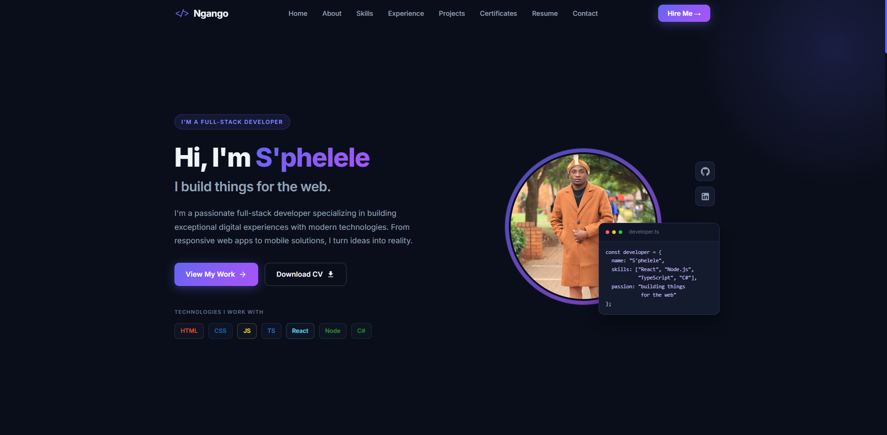

# S'phelele Lucas Khumalo — Portfolio


Personal portfolio of **S'phelele Lucas Khumalo** — Full-Stack Developer specializing in React, React Native, Node.js, and ASP.NET Core.

**Live site:** [sphelele-khumalo-portfolio.netlify.app](https://sphelele-khumalo-portfolio.netlify.app)



---

## About

A modern, dark-themed single-page portfolio built to showcase:

- Professional experience (Malcam Solutions, ICEP)
- Technical skills with progress indicators and real tech logos
- Featured projects (e.g. JourneyStore)
- Certificates
- Resume (view & download)
- Contact form (EmailJS)

---

## Features

- Responsive design (mobile, tablet, desktop)
- Modern dark UI with indigo/purple accents
- Smooth scroll navigation
- Skill bars with official technology logos
- Project cards ready for a multi-project grid
- Contact form powered by EmailJS
- Resume PDF viewer and download
- Optimized for Netlify continuous deployment from GitHub

---

## Tech stack

| Layer        | Technology                          |
|-------------|--------------------------------------|
| Framework   | React 18, TypeScript                 |
| Styling     | SCSS / Sass                          |
| UI          | MUI Icons, Font Awesome              |
| Contact     | EmailJS                              |
| Hosting     | Netlify                              |
| Build       | Create React App (`react-scripts`)   |

---

## Quick setup (local)

1. **Install Node.js** (v16+ recommended):  
   [https://nodejs.org/](https://nodejs.org/)

2. **Clone the repository**
   ```bash
   git clone https://github.com/S-phelele/NgangoPortfolio_Website.git
   cd NgangoPortfolio_Website
   ```

3. **Install dependencies**
   ```bash
   npm install
   ```

4. **Start the development server**
   ```bash
   npm start
   ```

5. Open [http://localhost:3000](http://localhost:3000) in your browser.

The app reloads on save. Lint errors appear in the terminal/console.

---

## Project structure

```
src/
├── components/          # Page sections
│   ├── Navigation.tsx
│   ├── Main.tsx         # Hero
│   ├── About.tsx
│   ├── Expertise.tsx    # Skills
│   ├── Timeline.tsx     # Experience
│   ├── Project.tsx
│   ├── Certificate.tsx
│   ├── Resume.tsx
│   ├── Contact.tsx
│   └── Footer.tsx
├── assets/
│   ├── images/          # Profile, project screenshots
│   └── styles/          # SCSS per section
├── App.tsx
└── index.scss           # Global theme & utilities
public/
├── resume.pdf           # Downloadable resume
└── index.html
```

---

## Customization

| What to change        | Where                                      |
|-----------------------|--------------------------------------------|
| Name, bio, links      | `src/components/Main.tsx`, `About.tsx`     |
| Skills & levels       | `src/components/Expertise.tsx`             |
| Work history          | `src/components/Timeline.tsx`              |
| Projects              | `src/components/Project.tsx` (+ images)    |
| Certificates          | `src/components/Certificate.tsx`           |
| Contact / EmailJS     | `src/components/Contact.tsx`               |
| Resume PDF            | `public/resume.pdf`                        |
| Profile photo         | `src/assets/images/profile.jpg`            |
| Colors / theme        | `src/index.scss` (`:root` variables)       |

---

## Deployment (Netlify + GitHub)

This project is set up for **automatic deploys from GitHub**.

### Existing setup

- Repo: [S-phelele/NgangoPortfolio_Website](https://github.com/S-phelele/NgangoPortfolio_Website)
- Site: [sphelele-khumalo-portfolio.netlify.app](https://sphelele-khumalo-portfolio.netlify.app)
- Build command: `npm run build`
- Publish directory: `build`
- Config file: `netlify.toml`

### Deploy a new change

```bash
git add -A
git commit -m "Describe your update"
git push origin main
```

Netlify will detect the push, build, and publish automatically.

### Manual build (optional)

```bash
npm run build
# Output is in the `build/` folder — upload that to any static host if needed
```

---

## Scripts

| Command        | Description                    |
|----------------|--------------------------------|
| `npm start`    | Development server             |
| `npm run build`| Production build → `build/`    |
| `npm test`     | Run tests                      |

---

## Contact

- **GitHub:** [S-phelele](https://github.com/S-phelele)
- **LinkedIn:** [khumalosphelele4252](https://www.linkedin.com/in/khumalosphelele4252/)
- **Portfolio:** [sphelele-khumalo-portfolio.netlify.app](https://sphelele-khumalo-portfolio.netlify.app)

---

## License

MIT — free to use and adapt. Attribution appreciated but not required.

Built with care by **S'phelele Lucas Khumalo**.
